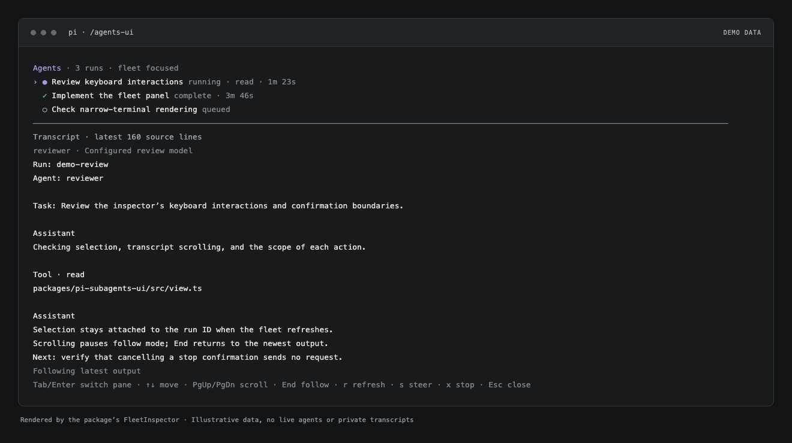

# Pi subagent UI

An optional WooStack extension for Pi. It puts a compact agent fleet beneath the editor and
opens a keyboard-driven transcript inspector. The separately installed **pi-subagents** package
still runs the agents, enforces session ownership, and handles steering, stops, and recovery.
This package is a UI adapter, not a runtime fork or an implementation of Orchestrate.



*Inspector rendered by the extension with illustrative demo data, not live agents or private transcripts.*

## Try it

Requires Pi with its extension/TUI APIs and pi-subagents with public RPC and async-status snapshot
v1. The current compatibility baseline is Pi 1.5.0 and pi-subagents 0.87.0. Newer versions must
preserve those contracts. Pi must already load pi-subagents in the same parent session.

From the WooStack checkout, load only this extension in addition to your normal configuration,
without installing it or changing settings:

```bash
pi -e ./packages/pi-subagents-ui/src/index.ts
```

No build or package-local install is required to run this TypeScript extension in Pi.
Use `/agents-ui` or **Ctrl+Shift+U** to open the inspector. Some terminals cannot distinguish the
shifted shortcut; the command always works. Nothing is launched when the inspector opens.
The panel stays empty until there are runs; a missing or incompatible runtime gets an actionable
error instead. Use `/agents-ui hide` or `/agents-ui show` to toggle this package's panel for the
current Pi runtime.

For a persistent local installation, run this yourself from the checkout:

```bash
pi install ./packages/pi-subagents-ui
```

That command changes Pi's package settings. Keep the checkout in place afterward. Installing
WooStack's skills does **not** install this extension or pi-subagents. The package is currently
private and is not published to npm.

### Avoid duplicate fleet panels

This package does not change pi-subagents configuration or replace its registered tool renderer.
If you want only this fleet panel, merge these display options into your existing pi-subagents
configuration, following the installed package's `docs/configuration.md`:

```json
{
  "fleetView": false,
  "asyncWidget": false,
  "inlineToolDisplay": "summary"
}
```

These are **pi-subagents options**, not top-level Pi settings. They suppress its fleet/async
widgets and condense tool display; they do not remove all native chat or tool-result rows.
Disabling the native widgets does not disable the runtime's change notifications.

## Inspector

The inspector has a fleet list and a transcript pane. It uses the active Pi theme and presents
state text alongside symbols, so status never depends on color alone.

| Key | Action |
| --- | --- |
| Up / Down | Select a run, or scroll when the transcript pane is focused |
| Tab / Enter | Switch between fleet selection and transcript scrolling |
| Page Up / Page Down | Scroll the transcript from either pane |
| Home / End | Go to the oldest loaded output / resume following the latest output |
| `r` | Refresh status and the selected transcript; reconnect if necessary |
| `s` | Open an editor to steer a running standalone background agent |
| `x` | Confirm a stop request for an eligible background run |
| Escape / Ctrl+C | Close the inspector without stopping agents |

Pi's configured select up/down, confirm, and cancel keybindings are also honored.
Transcripts are plain text with terminal controls stripped. The viewer requests the latest
160 source lines, then wraps them to the terminal width; it is not a full-history transcript
browser. New output follows the bottom until you scroll away. Runtime events refresh the panel
and the selected transcript; a local elapsed-time clock does not poll the runtime.

### Targeting and limits

- **Standalone background agent:** transcript, explicit steering, and confirmed stop.
- **Workflow:** whole-run overview and confirmed whole-run stop. The confirmation names this
  scope. This version does not route steering or transcript selection to nested workflow children;
  use pi-subagents' native inspector for those controls.
- **Foreground child:** transcript with its explicit `(runId, index)` from tool progress; no stop
  or steering controls. Foreground rows are observed during this UI runtime and are not rebuilt
  from older session history after reload.
- Async rows come from the runtime's bounded snapshot. An omitted-run count is shown rather than
  pretending the list is exhaustive. Completed rows depend on runtime retention; this UI is not
  an audit log. Foreground display history is bounded separately and active rows are not evicted.
- A stop reply acknowledges a **request**. It does not prove the writer or its processes have
  exited. Do not reuse a writer's workspace based on the UI's confirmation alone.
- A steering/stop timeout has an **unknown outcome** and is never retried automatically. Inspect
  runtime status before deciding what to do next. Steering requires the advertised non-recovering
  RPC guarantee; this UI never revives a child.
- The extension runs only in Pi's interactive terminal mode. It adds no widgets, runtime RPC
  requests, or background polling in print, RPC, or headless SDK modes.

Session shutdown/reload removes subscriptions, closes the inspector, and rejects pending UI
requests. UI state is memory-only. The extension never reads child files directly, rewrites
retained runs, creates worktrees, manages Git/PRs, launches agents, or changes approval policy.

## Development

From the repository root:

```bash
pnpm install --frozen-lockfile
pnpm --filter @woostack/pi-subagents-ui verify
```

There is no bundling step: Pi loads `src/index.ts`. Development dependencies pin the tested host
APIs for type checking; the running extension uses Pi's own modules. The backend is deliberately
not a Node dependency: communication uses the public in-process event bus, so pi-subagents stays
independently installed and updatable.

The tests exercise the actual RPC client, controller, renderer, and extension entrypoint with a
mock event-bus peer and host UI. They cover request correlation, timeouts, session scoping,
notification bursts, stale replies, width limits, terminal-control sanitization, workflow action
scope, steering cancellation, stop confirmation, and shutdown cleanup. These tests do not prove
that a real child model ran or that Orchestrate completed its delivery workflow.

For a manual host smoke, load both extensions in Pi, open `/agents-ui`, resize the terminal, and
close it with Escape. With an existing authorized run, check selection, live output, scroll/follow,
steering cancellation, stop cancellation, and session reload. Testing a real steering or stop
requires a disposable run and explicit permission to affect it.

Licensed under the repository's [MIT license](../../LICENSE).
